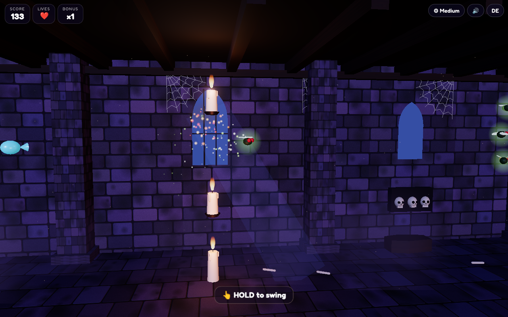

# 🕷️ Spider Drop

A cinematic 3D Halloween browser game. A cute little spider swings on its silk thread through a candle-lit crypt full of cobwebs, coffins, skulls and drifting dust. Shoot silk, swing, let go at the right moment and fly on — catch flies and candy, and steer clear of candle flames, bats and a giant fly swatter.

**Play:** https://frank-otto.github.io/spider-drop/

## How to play (in 5 seconds)
- **One button.** **Hold** (mouse button, finger on the screen, **Space / ↑ / W**) to shoot silk to the ceiling ahead and swing. **Let go** to fly off and keep the momentum.
- **Flies** (+10) and **candy** (+50). A rare **golden candy corn** gives +200 and a life back, with a short slow-motion moment.
- **Candle flames**, **bats** and the swinging **fly swatter** cost a life, and so does touching the **floor** (you bounce back up).
- Catch things in a row for a **bonus multiplier** (up to ×5). Distance counts too.

Difficulty: **Easy** (gentler gravity, wide gaps, slow bats and swatters, 5 lives), **Medium** (3 lives) and **Hard** (stronger gravity, denser hazards, fast swatters, 2 lives, ×1.5 points). Chosen in the menu and remembered; each has its own highscore.

**Kids mode:** a calm 60-second swing with softer gravity. The floor is bouncy and candles and bats only bump the spider — nothing is ever lost.

Extras: English by default with a **DE** toggle (remembered), shareable **highscore card** (PNG, 1080×1350), **quality levels** (Low / Mid / High / Ultra; steps down automatically if the frame rate drops), live demo spider in the menu.

## Tech
Three.js (WebGL): pendulum rope physics with sub-steps, a recycled gothic crypt (stone walls, pillars, moonlit windows with soft light shafts, niches with skulls, coffins, cobwebs, bones), flickering candle point lights, moonlight shadows, fog and dust particles, sparks, ACES tone mapping and a restrained bloom (high threshold, no glare). Bundled with esbuild into one classic script, so it runs straight from `file://`. All sounds are real recorded CC0 samples embedded in the page.

## Run locally
Open `index.html` directly (no server needed; on a Mac you can also double-click `start.command`). To rebuild after editing `src/`:
```
npm install && npm run build
```

## Tests
`python3 test/test_game.py` (Playwright + Chrome, headless WebGL, 47 checks): no console errors, EN/DE toggle and memory, fun within 5 s, mouse / keyboard / touch controls, pendulum physics, candle / bat / swatter / floor hits, golden candy corn, game over, highscore per difficulty, PNG card, difficulty levels, kids mode, mobile portrait, all quality levels, sample decoding, no synth sounds.

## Credits
All sounds are recorded CC0 samples (see `LICENSES/SOUNDS.md`). Three.js (MIT). Font: Fredoka (SIL Open Font License 1.1).


